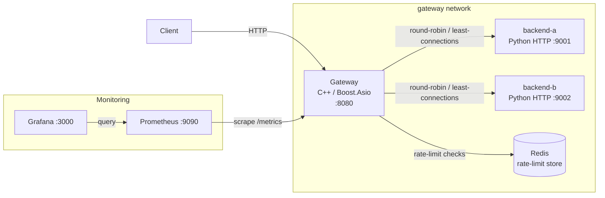

# C++ API Gateway

High-performance API gateway that routes HTTP requests to multiple backend services with health monitoring, load balancing, circuit breaking, retries, and rate limiting. Written in C++ using Boost.Asio with Redis-backed rate limiting.

## Features

- Load balancing: Round-robin (default) and least-connections strategies
- Health checks with automatic backend health tracking
- Circuit breaker per backend with failure thresholds and recovery
- Retry with failed-backend exclusion on retry attempts (maximum one retry)
- Rate limiting: in-memory and Redis-backed implementations
- Graceful shutdown with bounded grace period
- Metrics endpoint for observability
- Docker Compose for local stack (gateway, backends, Redis, Prometheus, Grafana)
- Threaded Python backends (original baseline) and asyncio Python backends (default in Compose)


## Architecture

The gateway is a C++ application built on Boost.Asio. It runs a single-threaded
`io_context` (a single `io_context::run()` call on the main thread; see
`src/main.cpp`). Sample backends are Python HTTP servers. The default Compose
stack runs the asyncio backend (`backend/backend_asyncio.py`, selected via
`--mode asyncio`); the original threaded backend (`backend/backend.py`) is
retained as the benchmark baseline. Redis provides the distributed rate-limit
store; Prometheus and Grafana provide monitoring only and do not carry request
traffic.



Request flow: client -> gateway (`:8080`) -> load balancer selects a healthy
backend -> request forwarded -> backend responds -> gateway returns the response.
A per-backend circuit breaker protects failing backends, the health checker
monitors liveness, and retries (when eligible) exclude the backend that just
failed.


## Build

Prerequisites:

- **C++20** (the project sets `CMAKE_CXX_STANDARD 20` in `CMakeLists.txt`)
- CMake (>= 3.14-era project; CI uses the Ubuntu release CMake)
- Boost (headers, including Boost.Asio and Boost.Redis headers)
- **OpenSSL** — a required dependency (`find_package(OpenSSL REQUIRED)`; links `OpenSSL::SSL` and `OpenSSL::Crypto`)
- A build generator: Ninja (used by CI) or Make
- Python 3 (for the sample backends only)

```bash
mkdir -p build
cd build
cmake -S .. -B . -DCMAKE_BUILD_TYPE=Release
cmake --build . --parallel
```

CI configures with the Ninja generator and `-DCMAKE_BUILD_TYPE=Release`; locally
you may use Ninja (`-G Ninja`) or the default generator.

Binary: `build/api_gateway.exe` (Windows) or `build/api_gateway` (Linux).


## Testing

```bash
cd build
ctest --output-on-failure
```

CTest registers **18 tests** (confirm with `ctest --test-dir build -N`, which
prints `Total Tests: 18`). Each registered CTest test corresponds to one test
executable compiled from the `tests/` directory; this is **not** the same as the
number of test source files. Among them are three Redis-dependent tests —
`RedisConnectionTest`, `RedisRateLimitStoreTest`, and `RedisRateLimitConcurrencyTest`
(registered as separate CTest tests #4, #5, #6).

When Redis is not reachable at the endpoint they expect (`REDIS_HOST`/`REDIS_PORT`,
defaulting to `127.0.0.1:6379`), those three tests report a skip (exit code 77)
and CTest marks them as skipped/not-run. The expected no-Redis breakdown is
therefore **15 passed, 3 skipped, 0 failed**. The exact totals of the previously
reported run cannot be independently verified, because the complete CTest log
is unavailable (the retained log is only a test-listing stub). Skipped tests are
not passing tests.

With Redis reachable, all 18 registered tests can run; this documentation does
not claim they all pass without an actual test result. To run them locally, start
a Redis instance reachable at `REDIS_HOST`/`REDIS_PORT`.

CI (`.github/workflows/ci.yml`) is configured to run the same CTest command with
a Redis service container published on `127.0.0.1:6379`, and sets `REDIS_HOST` /
`REDIS_PORT` accordingly, so the Redis-dependent tests are intended to execute
there. CI pass/fail has not been re-verified in this audit.


## Docker Compose

Normal stack (default uses asyncio backends):

```bash
docker compose up -d --build
# inspect
docker compose ps
curl http://localhost:8080/api/status   # gateway-native status
curl http://localhost:8080/metrics      # gateway-native Prometheus metrics
curl http://localhost:8080/health       # forwarded to a backend
# logs
docker logs cpp-api-gateway
docker logs cpp-api-gateway-backend-a
docker logs cpp-api-gateway-backend-b
# shutdown (safe; does not remove volumes)
docker compose down
```

Ports (host, from `docker-compose.yml`): gateway `8080`
(`GATEWAY_HOST_PORT`), Prometheus `9090` (`PROMETHEUS_HOST_PORT`), Grafana
`3000` (`GRAFANA_HOST_PORT`). Backends listen on `9001`/`9002` and are **not**
published to the host; they are reachable only on the Compose `gateway`
network via service names (`backend-a:9001`, `backend-b:9002`). Redis is on the
internal network only, with no persistence volume (rate-limit buckets are
rebuildable).

Container names: `cpp-api-gateway`, `cpp-api-gateway-backend-a`,
`cpp-api-gateway-backend-b`, `cpp-api-gateway-redis`,
`cpp-api-gateway-prometheus`, `cpp-api-gateway-grafana`.


## Endpoints

- `GET /` and any other path — routed to a backend selected by the load
  balancer (example route).
- `GET /health` — **not a gateway-native endpoint**. This path is forwarded to a
  backend like any other regular request; the backend returns its own health
  response (for example `{"status": "ok", "backend": "backend-a"}`). There is no
  special handling for `/health` in the gateway.
- `GET /api/status` — gateway-native status endpoint. Handled directly by the
  gateway (exact path match) and reports backend health and circuit-breaker
  state, for example:
  `{"status":"healthy","active_connections":1,"rate_limiting":{"enabled":true},"backends":[{"host":"backend-a","port":9001,"healthy":true,"circuit":"CLOSED","failure_count":0}, ...]}`
- `GET /metrics` — gateway-native Prometheus metrics endpoint. Exact path match;
  **no trailing slash** is used. Requesting `/metrics/` is not the native
  endpoint and would be treated as a normal (proxied) path.

Both `/api/status` and `/metrics` bypass the normal rate-limit and backend
pipeline. `/metrics` responses use `Connection: close` semantics.

### Status codes

The gateway emits the following status codes (verified from `src/server.hpp`):

- **429 Too Many Requests** — the request was rejected by the rate limiter
  (also increments `rate_limit_rejected_total`).
- **503 Service Unavailable** — no healthy backend is available/could be
  selected, or the gateway is draining during shutdown (a `Connection: close`
  signal is sent while draining).
- **504 Gateway Timeout** — the overall request deadline (`REQUEST_TIMEOUT_MS`)
  expired (also increments `request_timeouts_total`).

Successful proxied responses carry the backend's status (typically `200`).


## Configuration

Configuration is read from environment variables at startup
(`src/config.cpp`) into `GatewayConfig` (`src/gateway_config.hpp`). When a
variable is unset, the built-in default is used. Docker Compose supplies
container-appropriate overrides in the `gateway` service's `environment` block
(`docker-compose.yml`), so Compose values take precedence over application
defaults inside the stack.

| Environment variable | Config field | Default | Accepted values |
| -------------------- | ------------ | ------- | --------------- |
| `GATEWAY_PORT` | `port` | `8080` | valid TCP port |
| `BACKENDS` | `backends` | `127.0.0.1:9001,127.0.0.1:9002,127.0.0.1:9003` | comma-separated `host:port` list (at least one entry) |
| `LOAD_BALANCING_STRATEGY` | `load_balancing_strategy` | `ROUND_ROBIN` | `ROUND_ROBIN`, `LEAST_CONNECTIONS` |
| `RATE_LIMITING_ENABLED` | `rate_limiting_enabled` | `true` | `true`/`false` (also `1`/`0`) |
| `RATE_LIMIT_CAPACITY` | `rate_limit_capacity` | `100` | number (token bucket capacity) |
| `RATE_LIMIT_REFILL_RATE` | `rate_limit_refill_rate` | `10` | number (tokens per second) |
| `REDIS_HOST` | `redis_host` | `127.0.0.1` | hostname |
| `REDIS_PORT` | `redis_port` | `6379` | port string |
| `BACKEND_CONNECT_TIMEOUT_MS` | `backend_connect_timeout` | `2000` | positive integer (ms) |
| `BACKEND_RESPONSE_TIMEOUT_MS` | `backend_response_timeout` | `5000` | positive integer (ms) |
| `REQUEST_TIMEOUT_MS` | `request_timeout` | `10000` | positive integer (ms) |
| `SHUTDOWN_GRACE_PERIOD_MS` | `shutdown_grace_period` | `5000` | positive integer (ms) |

Notes:

- `BACKENDS` has no default in the gateway binary only when explicitly set; if
  `BACKENDS` is unset the application defaults to the three `127.0.0.1` entries
  above (used for local, non-Compose runs). Compose sets
  `BACKENDS=backend-a:9001,backend-b:9002`.
- Invalid enum/bool/port values cause startup to fail with a clear error rather
  than silently falling back.

### Timeout semantics

- `BACKEND_CONNECT_TIMEOUT_MS` (`backend_connect_timeout`, default 2000 ms) —
  bounds the TCP connect to a selected backend.
- `BACKEND_RESPONSE_TIMEOUT_MS` (`backend_response_timeout`, default 5000 ms) —
  bounds waiting for the backend response for an attempt.
- `REQUEST_TIMEOUT_MS` (`request_timeout`, default 10000 ms) — the overall
  request deadline; when it expires the gateway responds `504` and the request
  is not retried further.
- `SHUTDOWN_GRACE_PERIOD_MS` (`shutdown_grace_period`, default 5000 ms) —
  bounded grace period during graceful shutdown before remaining connections
  are force-closed.

Per-attempt timers are cancelled and reset between attempts; a fresh deadline
governs each backend retry. These semantics are taken from `src/server.hpp` and
`src/gateway_config.hpp`.


## Retry behavior

- **Maximum one retry** per request (`retry_count_ >= 1` disables further
  retries).
- Retryable methods only: `GET`, `HEAD`, `PUT`, `DELETE`, and `OPTIONS`.
  Non-idempotent methods such as `POST` and `PATCH` are **not** retried.
- On retry, the **backend that just failed is excluded** from the next
  selection. Per-attempt state (buffers, timers, callbacks) is cleared before
  the next attempt.
- No additional retry guarantees are provided beyond the above (for example,
  there is no retry on rate-limited requests, and the overall request deadline
  still applies across attempts).


## Monitoring

- **Prometheus** scrapes the gateway's `GET /metrics` endpoint (service
  `prometheus`, host port `9090`). Configuration lives in the Compose stack's
  Prometheus service; inspect it for the exact scrape target and interval.
- **Grafana** (host port `3000`, default login `admin`/`admin` per
  `docker-compose.yml`) queries Prometheus and is used for dashboards.
- Prometheus and Grafana observe the gateway's metrics; they do not proxy or
  handle request traffic.

Metrics counters exposed by the gateway include request totals, response counts
by status, backend failures, request timeouts, and rate-limit rejections (see
`src/metrics.cpp`). Only metrics actually exported by the implementation are
listed here; additional dashboards/alerts are not asserted.


## Benchmarks

Controlled benchmarks are documented in `bench_results/SUMMARY.md`, produced with
the scripts in `scripts/bench_case.sh` and `run_bench_proper.sh` and the
`docker-compose.bench-*.yml` variants.

- **Historical RR vs least-connections comparisons** (older `wrk_*.txt`
  results) are reported separately in the summary.
- **Newer threaded-vs-asyncio comparisons** (asyncio backend migration
  validation) are also reported separately.

Measurements were taken locally (Windows / Docker Desktop, limited CPU/memory)
and show non-trivial run-to-run variability. Raw run directories are preserved
locally rather than treated as committed fixtures. These results are **not**
production performance guarantees. Benchmarks are not rerun as part of
documentation.


## CI and status

- `.github/workflows/ci.yml` builds the project (Ubuntu, Ninja, Release) and runs
  CTest with a Redis service container published at `127.0.0.1:6379`, setting
  `REDIS_HOST` / `REDIS_PORT` so the Redis-dependent tests can execute.
- Test registration: 18 CTest tests (`ctest --test-dir build -N`). With Redis
  unreachable, the expected breakdown is 15 passed, 3 Redis-dependent skipped,
  0 failed; the exact historical run totals are not independently verifiable
  because the complete test log is unavailable.
- Implemented features: round-robin and least-connections balancing; backend
  health checks; per-backend circuit breakers and failover; one-retry policy
  with failed-backend exclusion; in-memory and Redis-backed rate limiting;
  connect/response/request timeouts; graceful shutdown; metrics endpoint;
  Prometheus/Grafana Compose services.

Known limitations / prerequisites: Redis-dependent tests require a reachable
Redis; Windows builds use the same CMake flow but were not independently
verified in CI in this audit; benchmark numbers are local and variable.


## Troubleshooting

- **Build cannot find Boost / OpenSSL** — install Boost headers (including
  Boost.Redis headers) and OpenSSL development packages, and point CMake at
  them (CI uses `-DBOOST_ROOT=/usr/local -DBoost_NO_SYSTEM_PATHS=ON`).
- **Redis-dependent tests are skipped** — start a Redis reachable at
  `REDIS_HOST`/`REDIS_PORT` (default `127.0.0.1:6379`); skipped tests are not
  passes.
- **Gateway container unhealthy** — its health check calls
  `GET /api/status` on the container-internal `GATEWAY_PORT`; check
  `docker logs cpp-api-gateway` and confirm Redis and both backends are
  healthy (`docker compose ps`).
- **Backends unreachable from the gateway** — backends are addressed by
  Compose service name on the `gateway` network (`BACKENDS=backend-a:9001,backend-b:9002`),
  not via `localhost`.
- **`/metrics/` returns unexpected content** — the native endpoint is
  `GET /metrics` (no trailing slash).
- **Requests succeed locally but not from host** — backends are not published
  to the host; only the gateway (`8080`), Prometheus (`9090`), and Grafana
  (`3000`) are exposed.
